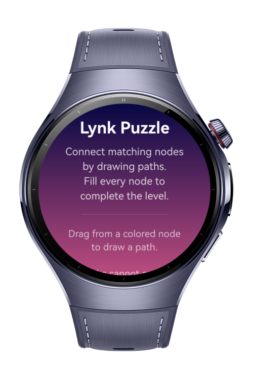
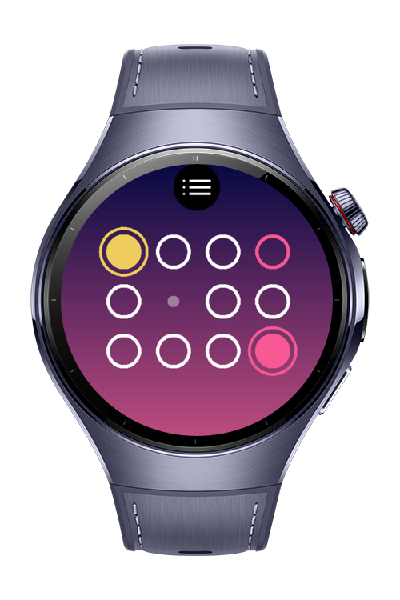
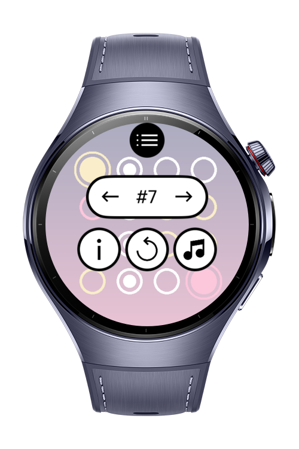
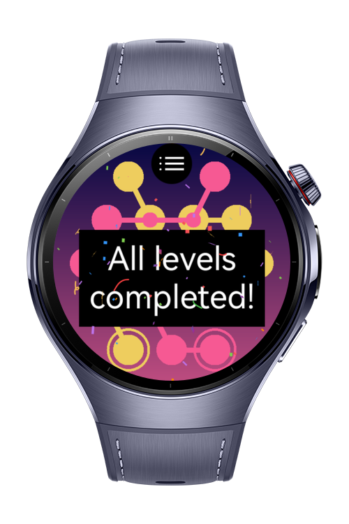

> **Note:** To access all shared projects, get information about environment setup, and view other guides, please visit [Explore-In-HMOS Index](https://github.com/Explore-In-HMOS/hmos-index).

# Lynk Puzzle Game
Lynk Puzzle Game is a casual wearable game where players connect all nodes by drawing paths. A level is completed once all nodes are filled. Various node types add depth and variety to the gameplay.

# Preview
<div>
  
  
  
  
</div>

# Use Cases
- Quick Play: Users can start a quick game session during short breaks or idle moments
- Level Progression: Players progress through increasingly difficult dot-connecting puzzle

# Tech Stack
**Languages**: ArkTS, ArkUI  
**Libraries/Kits**:
- @ohos/lottie
- @kit.ArkGraphics2D
- @kit.ArkUI
- @ohos.util.HashMap
- @ohos.data.preferences
- @kit.MediaKit
- @kit.AudioKit

# Directory Structure
```
entry/src/main/
├── ets/
│   ├── components/
│   │   ├── ConfettiLottie.ets
│   │   └── GameCanvas.ets
│   ├── core/
│   │   └── Game.ets
│   ├── entryability/
│   │   └── EntryAbility.ets
│   ├── entrybackupability/
│   │   └── EntryBackupAbility.ets
│   ├── pages/
│   │   ├── GamePage.ets
│   │   ├── Index.ets
│   │   └── InfoScreen.ets
│   └── utils/
│       ├── GlobalContext.ets
│       └── ResourceUtils.ets
├── module.json5
└── resources/
    ├── base/
    │   ├── element/
    │   │   ├── color.json
    │   │   ├── float.json
    │   │   └── string.json
    │   ├── media/
    │   │   ├── background.png
    │   │   ├── foreground.png
    │   │   ├── info.png
    │   │   ├── layered_image.json
    │   │   ├── list.png
    │   │   ├── listwhite.png
    │   │   ├── music.png
    │   │   ├── music_off.png
    │   │   ├── replay.png
    │   │   └── startIcon.png
    │   └── profile/
    │       ├── backup_config.json
    │       └── main_pages.json
    ├── dark/
    │   └── element/
    │       └── color.json
    └── rawfile/
        ├── confetti.json
        ├── confetti.mp3
        ├── drop-thunk.mp3
        ├── level1.json
        ├── level10.json
        ├── level2.json
        ├── level3.json
        ├── level4.json
        ├── level5.json
        ├── level6.json
        ├── level7.json
        ├── level8.json
        ├── level9.json
        └── reverse-thunk.mp3
```

# Constraints and Restrictions
## Supported Devices
- Huawei Watch 5
- DevEco Studio Simulator

# LICENSE
**Lynk Puzzle Game** is distributed under the terms of the **MIT License**.
See the [LICENSE](/LICENSE) for more information.
